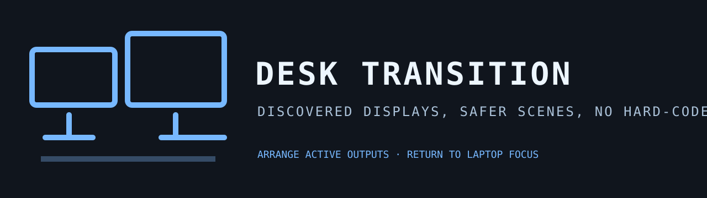
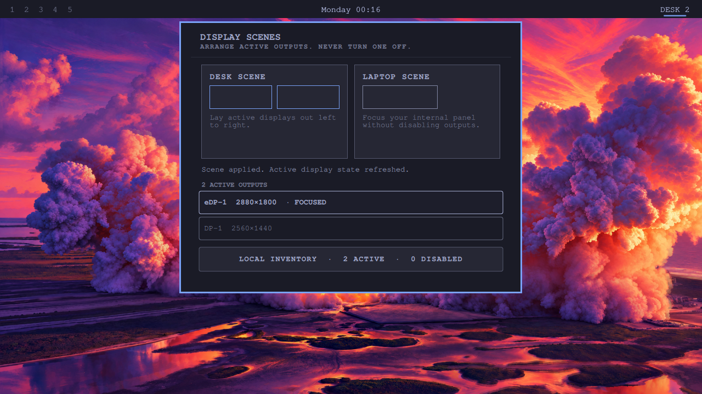

# Desk Transition



[](https://ko-fi.com/U5S225PTME)

Desk Transition gives Hyprland two local display actions: **Desk** lays every
active output out left to right, while **Laptop** focuses the first active eDP
or LVDS panel. It never hard-codes output names or disables a display.

Desk changes position only. Each output keeps its mode, refresh rate, scale and
rotation, and advances by its scaled width, so a HiDPI laptop panel next to a
desk monitor lines up without a gap or an overlap.



The committed preview is a direct 1280 by 720 capture from the isolated Buzz
Omarchy rig. It shows a rig-only fixture, not real hardware: a deterministic
two-output Hyprland inventory (a HiDPI laptop panel and a 1440p desk monitor)
behind a stand-in `hyprctl` that answers like Hyprland 0.57 with a Lua config.
The unchanged plugin scanned that inventory, applied both scenes through live
shell IPC, proved that no disable command was emitted, and opened the populated
panel. `.render-proof.json` binds the exact source package, runtime log, action
log, fixture, screenshot, and a recorded visual inspection. The receipt names
the inspector and the hash they inspected.

Every action reads a fresh monitor list and validates the selected name before
dispatching a Hyprland command. With no Hyprland session it reports an empty
state rather than guessing at hardware.

## Hyprland versions

Hyprland 0.57 reads a Lua config, and there `hyprctl keyword` no longer exists.
Each action sends the Lua form first and the classic form second, for older
releases:

```bash
# Lua form, tried first (classic form: hyprctl dispatch focusmonitor eDP-1)
hyprctl dispatch 'hl.dsp.focus({ monitor = "eDP-1" })'
hyprctl eval 'hl.monitor({ output = "eDP-1", position = "0x0" })'
```

Desk sends one `eval` for all outputs, so none passes through a half-moved
layout. An attempt counts only when `hyprctl` prints `ok` and exits 0, so a Lua
miss or a syntax error is never reported as success. The classic fallback
replaces a whole monitor rule, so it passes each output's current mode, refresh
rate, scale and rotation back in. An output that mirrors another is left out of
the layout.

On 0.57 Desk merges into an output's own connector rule, which is what the
display panel's saved settings and a connector-named rule in `monitors.lua`
are. An output set only by a wildcard `output = ""` or `desc:` rule has no such
rule, so Hyprland starts a new one at the preferred mode and automatic scale.

The panel footer reads the compositor: how many outputs are active and how many
the system has disabled, for example with the lid closed.

## Keyboard

Arrow keys or `h` `j` `k` `l` move between Desk, Laptop and each output, Enter
or Space applies the selected one, and Escape closes. Nothing is selected when
the panel opens, so Enter alone changes nothing.

## Install

```bash
omarchy plugin add \
  https://github.com/jeremylongshore/omarchy-desk-transition-entry --enable
```

Use Desk to arrange active outputs, Laptop to refocus the internal panel, or
select a detected monitor directly.

## Verify

```bash
npm test
npm run test:race
npm run test:mutation
npm run audit
npm audit --audit-level=low
shellcheck --severity=warning scripts/*.sh e2e/*.sh .githooks/pre-push
bash scripts/run-plugin-gates.sh
bash scripts/check-lane-freshness.sh
npm run test:e2e
```

After inspecting the exact new preview at marketplace scale, bind approval with
`scripts/approve-preview.sh`. C43 blocks submission when copy is not exactly
500 characters, the banner is unsafe or missing, the Buzz receipt is stale, or
the preview hash has not received a recorded visual approval.

The Hyprland side is proven from the v0.57.2 and v0.54.3 sources and a
stand-in `hyprctl`, because the rig has no live compositor.
`tests/TESTING.md` has the live check to run on a real Omarchy laptop.

## Maintainers wanted

These plugins are growing, and we are looking for dependable Omarchy users who
want to review issues, test releases, and keep a plugin healthy over time. Start
with a small pull request or [open a maintainer interest issue](https://github.com/jeremylongshore/omarchy-desk-transition-entry/issues/new?template=maintainer_interest.md&title=Maintainer%20interest%3A%20)
titled **Maintainer interest**. Tell us which plugin you use and how you want to
help. Consistent contributors can earn maintainer responsibility.

## License

MIT
